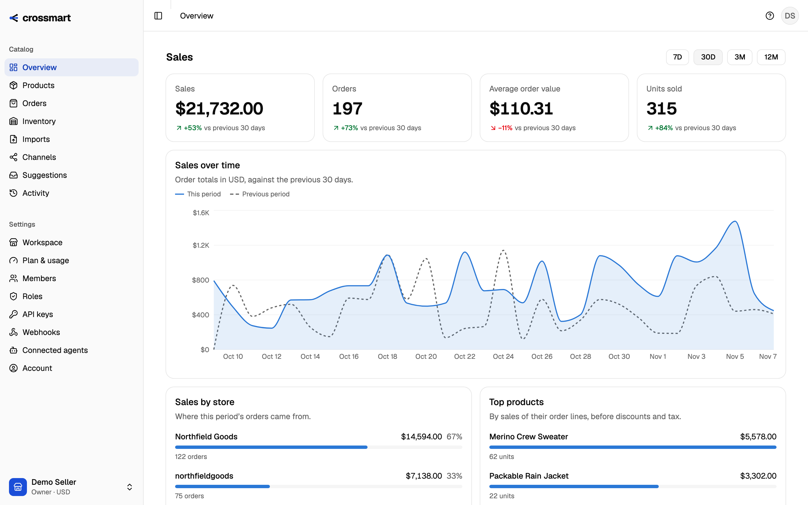
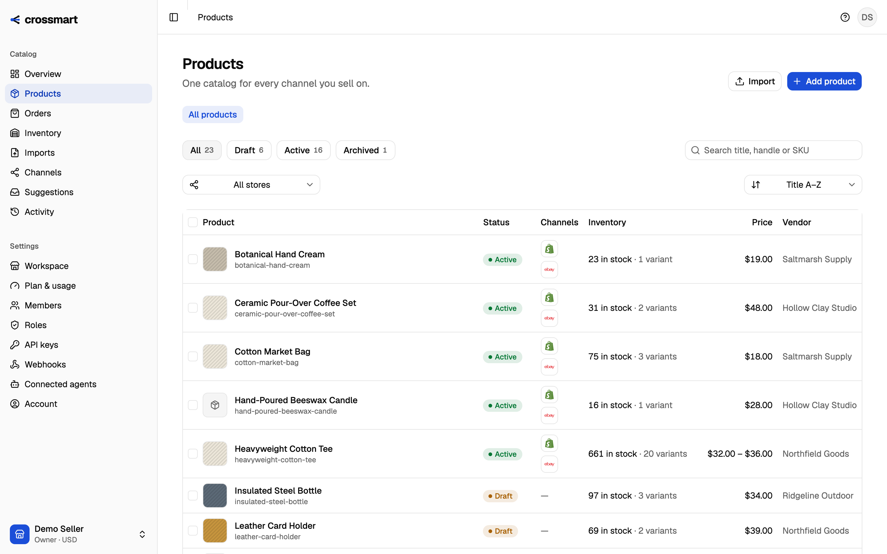
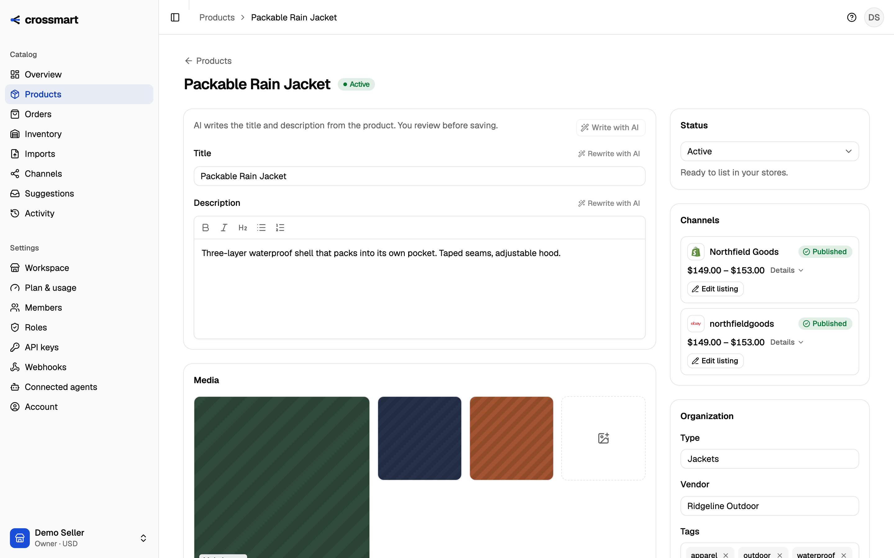
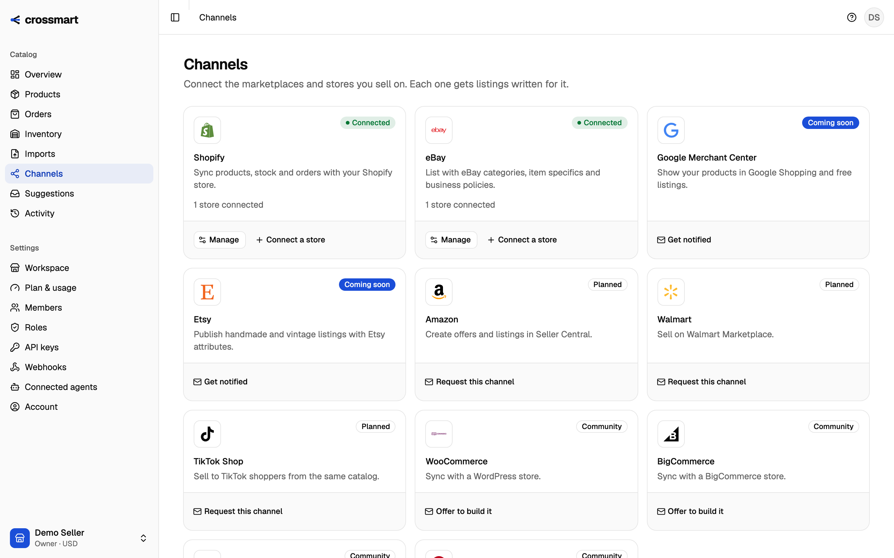
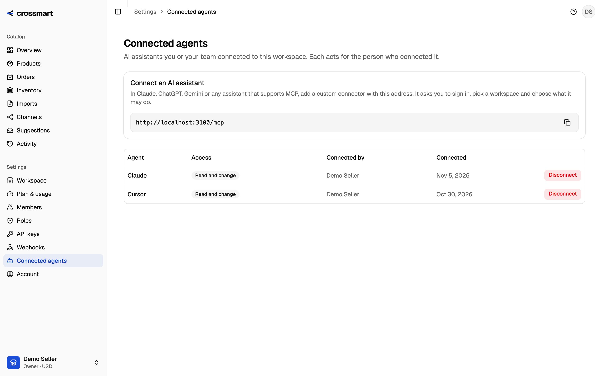

<div align="center">

# crossmart

**The open-source multichannel listing platform for sellers and their AI agents.**

Manage listings, inventory and orders on Shopify and eBay today, with Google Merchant and Etsy
on the way, from one dashboard or straight from Claude & ChatGPT.

[Website](https://crossmart.io) · [Docs](https://docs.crossmart.io) · [Developers](docs/developers/README.md) · [Architecture](docs/architecture.md)

</div>

> [!NOTE]
> Crossmart is young and moving fast. Shopify and eBay are live, and more channels are on the way. Until 1.0, APIs may change; breaking changes are announced and versioned under `/api/v1`.



|                                                                                              |                                                                                                         |
| -------------------------------------------------------------------------------------------- | ------------------------------------------------------------------------------------------------------- |
|  |  |
| One catalog for every channel                                                                | Publish a product to every store                                                                        |
|                  |           |
| Connect your stores                                                                          | Let your AI agents work through MCP                                                                     |

## Why Crossmart

- **One catalog, every marketplace.** Create or import products once, then publish tailored listings to every channel.
- **AI does the busywork.** Agents write channel-specific content, map categories and attributes, and fix marketplace rejections. You review and approve.
- **Built for agents.** Everything in the dashboard is available through a REST API and an MCP server, so your own AI agent can run your catalog.
- **No overselling.** A single inventory ledger with real-time order ingestion and last-unit protection keeps every channel in sync.
- **Open source.** Self-host it for free, or use [Crossmart Cloud](https://crossmart.io) and skip marketplace app approvals.

## Project status

Crossmart is pre-1.0. The catalog, the stock ledger, the REST API, the SDKs and the MCP server
work end to end, but APIs and data models can still change between releases.

| Channel                             | Status                                                          |
| ----------------------------------- | --------------------------------------------------------------- |
| Shopify                             | Live                                                            |
| eBay                                | Live (a self-hosted instance uses eBay sandbox keys by default) |
| Google Shopping (Merchant Center)   | Coming soon                                                     |
| Etsy                                | Coming soon                                                     |
| Mercado Libre                       | Coming soon                                                     |
| Falabella (Chile, Colombia, Peru)   | Preview                                                         |
| Amazon, Walmart, TikTok Shop        | Planned                                                         |
| WooCommerce, BigCommerce and others | Community contributions welcome                                 |

The [channel status page](https://docs.crossmart.io/channels/) is kept up to date as connectors
ship.

**Plans:** Crossmart Cloud has plans sized by active listings. On a self-hosted instance plan
limits are reported but not enforced unless you set `ENTITLEMENTS_ENFORCED=true`.

## Repository layout

| Path               | What it is                                                |
| ------------------ | --------------------------------------------------------- |
| `apps/api`         | REST API (NestJS)                                         |
| `apps/worker`      | Background jobs: channel sync, orders, AI agents (BullMQ) |
| `apps/mcp`         | MCP server that exposes the API to AI agents              |
| `libs/core`        | Domain modules shared by the API and worker (tenancy, …)  |
| `libs/common`      | Configuration, constants and shared utilities             |
| `libs/database`    | Prisma schema, migrations and client                      |
| `libs/connectors`  | Marketplace connector SDK and connectors                  |
| `sdks/typescript`  | `@crossmart/sdk`, the TypeScript client of the REST API   |
| `sdks/python`      | `crossmart` on PyPI, the Python client of the REST API    |
| `sdks/php`         | `crossmart/crossmart-php`, the PHP client of the REST API |
| `integrations/n8n` | `n8n-nodes-crossmart`, n8n nodes and a polling trigger    |

The web app lives in [crossmart-io/crossmart-web](https://github.com/crossmart-io/crossmart-web).

## Quick start (development)

Requirements: Node.js 22 or 24 (`.nvmrc` pins 24, the version the Docker images use), pnpm 10,
and Docker (or your own PostgreSQL and Redis, see below).

```bash
pnpm install
cp .env.example .env                  # then fill in the secrets, see below
docker compose up -d postgres redis   # set POSTGRES_PORT / REDIS_PORT if 5432 / 6379 are taken
pnpm db:generate                      # generates the Prisma client; the build needs it
pnpm db:deploy                        # applies the migrations
pnpm start:api                        # http://localhost:3000/api/docs
pnpm start:worker
```

In `.env`, set:

| Variable                               | How                                                                                              |
| -------------------------------------- | ------------------------------------------------------------------------------------------------ |
| `BETTER_AUTH_SECRET`                   | `openssl rand -base64 32`                                                                        |
| `POSTGRES_PASSWORD` / `REDIS_PASSWORD` | `openssl rand -hex 24`, and put the same values in `DATABASE_URL` and `REDIS_URL`                |
| `CREDENTIALS_MASTER_KEY`               | `openssl rand -base64 32`. It encrypts channel credentials; without it no store can be connected |

Everything else is optional for running locally. The channel credentials (`SHOPIFY_*`, `EBAY_*`,
`GOOGLE_*`, `ETSY_*`, `MERCADOLIBRE_*`) only turn on connecting that channel; see
[docs/channels](docs/channels).
Without `ANTHROPIC_API_KEY` the app runs as usual and the AI features say AI is not configured.

`GET /api/v1/health` reports whether the API is up. It checks the database connection only.

### Without Docker

If you already run PostgreSQL 16+ and Redis 7+, skip `docker compose` and point `DATABASE_URL`
and `REDIS_URL` in `.env` at them. `POSTGRES_PASSWORD` and `REDIS_PASSWORD` are only read by
`compose.yaml`.

### Another port

`API_PORT` defaults to 3000. If you change it, change the URLs that contain it too:
`BETTER_AUTH_URL`, `MEDIA_PUBLIC_URL` and `CROSSMART_API_URL` in `.env`, and `VITE_API_URL` in
the web app's `.env.local`.

### Demo data

With the API running, `pnpm seed:demo` creates a local demo account and fills it with 23 products
and 116 variants from invented brands: sizes and colours, stock with a few sell-outs, drafts, and
products missing images or barcodes, so every screen has something to show. It goes through the
public API, so the data passes the same validation as anything a seller enters. It prints the demo
login when it is done (`DEMO_EMAIL` and `DEMO_PASSWORD` override it), and does nothing if that
workspace already has products. It talks to `API_URL`, `http://localhost:3000` by default. Never run it against a server other people can reach.

## Self-hosting

```bash
export BETTER_AUTH_SECRET="$(openssl rand -base64 32)"
export POSTGRES_PASSWORD="$(openssl rand -hex 24)"
export REDIS_PASSWORD="$(openssl rand -hex 24)"
docker compose --profile app up -d --build
```

This starts PostgreSQL, Redis, applies migrations, and runs the API and worker. Keep the three
secrets (for example in `.env` next to `compose.yaml`): compose refuses to start without them.
PostgreSQL and Redis require their passwords and publish their ports on `127.0.0.1` only, so
they are not reachable from other machines.

Compose also passes `CREDENTIALS_MASTER_KEY`, the channel credentials (`SHOPIFY_*`, `EBAY_*`,
`GOOGLE_*`, `ETSY_*`, `MERCADOLIBRE_*`), `ANTHROPIC_API_KEY` and `ENTITLEMENTS_ENFORCED` from the
shell or `.env` to the API and worker. Set `CREDENTIALS_MASTER_KEY` before you connect a store.

What compose does not include:

- **The web app.** It lives in [crossmart-io/crossmart-web](https://github.com/crossmart-io/crossmart-web).
  Its Docker image takes the API address as a build argument:
  `docker build --build-arg VITE_API_URL=https://api.example.com .` (see its
  [Dockerfile](https://github.com/crossmart-io/crossmart-web/blob/main/Dockerfile)).
- **The MCP server.** Build it with `docker build --build-arg APP=mcp .` or run it from source
  (see [Using Crossmart from Claude, ChatGPT or Cursor](#using-crossmart-from-claude-chatgpt-or-cursor)).

The stack assumes the API at `http://localhost:3000` and the web app at `http://localhost:5173`.
For another address, set `BETTER_AUTH_URL`, `CORS_ORIGINS` and `WEB_APP_URL` (in the shell or
`.env`), and change the published port in `compose.yaml` if needed.

**Upgrading an existing stack:** PostgreSQL sets its password only when the data volume is first
created. Keep the old one (`crossmart`) as `POSTGRES_PASSWORD`, or change it first with
`ALTER USER crossmart PASSWORD '…'` and then set the new value. Redis picks up `REDIS_PASSWORD`
when its container is recreated; add it to `REDIS_URL` (`redis://:<password>@host:6379`) for the
API and worker you run outside compose.

## Build on Crossmart

The [developer guide](docs/developers/README.md) covers the REST API (authentication, errors,
pagination), a [quickstart](docs/developers/quickstart.md) from product to store to order, the
[TypeScript](sdks/typescript/README.md), [Python](sdks/python/README.md) and [PHP](sdks/php/README.md)
SDKs, the [n8n nodes](docs/developers/n8n.md) and the [MCP server](docs/developers/mcp.md) for AI agents.

## Authentication

- **People** sign up and sign in through [Better Auth](https://www.better-auth.com) at `/api/auth/*` (email and password for now). The session is a cookie. Every new user gets an organization and a workspace they own.
- **Programs** (the MCP server, scripts) use a workspace API key in the `x-api-key` header. Keys are created at `POST /api/v1/workspaces/{workspaceId}/api-keys`, carry a role no higher than their creator's, are shown once and stored only as a SHA-256 hash.
- **Roles** per workspace: `OWNER`, `ADMIN`, `EDITOR`, `APPROVER`, `VIEWER`, each a set of fine-grained permissions ([docs/permissions.md](docs/permissions.md)). Routes declare the permission they need; callers outside the workspace get `404`.

## Catalog

- **Products** have base content (title, HTML description, vendor, type, tags, status), up to three options (Size, Color, Material) and up to 250 variants. Handles are unique per workspace, and so are SKUs. Prices are exact decimal strings (`"19.90"`) in the workspace currency.
- **Stock** lives in an append-only ledger (`inventory_movements`). Each variant's `available` caches the sum of its movements.
- **Edit** with `PUT /api/v1/workspaces/{workspaceId}/products/{productId}`. Variants sent with their `id` keep it, new ones are added, and missing ones are removed. A changed `quantity` is written to the ledger as an adjustment. Descriptions are sanitized on every write.
- **Images** upload to `POST /api/v1/workspaces/{workspaceId}/media/product-images`, which returns a URL to use in `media`. The format is read from the file's bytes: JPEG, PNG, WebP or GIF, never SVG. With `STORAGE_DRIVER=local` the API stores files in `STORAGE_LOCAL_DIR` and serves them at `/media`. Each file is at most 20 MB, and each workspace stores at most 5 GB of files (`413` past it); images a product no longer uses still count until orphan cleanup exists.
- **Import** a Shopify product export with `POST /api/v1/workspaces/{workspaceId}/product-imports` (multipart: `format=shopify_csv`, `file`). Products whose handle is already in the catalog are skipped, never overwritten. Invalid rows are reported with their spreadsheet row number. To add another format, implement `CatalogFileParser` and register it in `CatalogModule`.

## Using Crossmart from Claude, ChatGPT or Cursor

Crossmart has an MCP server, so an AI agent can run the catalog with the same rules as the dashboard. Create an API key in **Settings → Developers → API keys** (an Editor key is enough for most work), then add the server to your client. See [docs/mcp.md](docs/mcp.md) for the tools and the details.

**Remote** (Crossmart Cloud, or your own deployment run with `MCP_TRANSPORT=http`):

```json
{
  "mcpServers": {
    "crossmart": {
      "url": "https://mcp.crossmart.io/mcp",
      "headers": { "Authorization": "Bearer <your API key>" }
    }
  }
}
```

**Local** (stdio), after `pnpm build:mcp`:

```json
{
  "mcpServers": {
    "crossmart": {
      "command": "node",
      "args": ["/path/to/crossmart/dist/apps/mcp/main.js"],
      "env": { "CROSSMART_API_URL": "http://localhost:3000", "CROSSMART_API_KEY": "<your API key>" }
    }
  }
}
```

## Contributing

Contributions are welcome. Read [CONTRIBUTING.md](CONTRIBUTING.md) first. It covers the code standards, the commit format and the Contributor License Agreement.

## Getting help

- **Questions and chat:** join the community on [Discord](https://discord.gg/dWPQjnzWhf).
- **Ideas and longer threads:** [GitHub Discussions](https://github.com/crossmart-io/crossmart/discussions).
- **Bugs:** [GitHub Issues](https://github.com/crossmart-io/crossmart/issues).
- **Security vulnerabilities:** report them privately through [GitHub private vulnerability reporting](https://github.com/crossmart-io/crossmart/security/advisories/new) or security@crossmart.io, never in a public issue. See [SECURITY.md](SECURITY.md).
- **Anything else:** hello@crossmart.io.

See [SUPPORT.md](SUPPORT.md) for what to expect.

## License

Copyright YIOT LLC.

- The platform (this repository, unless stated otherwise) is licensed under the [GNU Affero General Public License v3.0](LICENSE).
- The SDKs in `sdks/` and the n8n node in `integrations/n8n` are licensed under the MIT License (see the `LICENSE` file in each).
- The agent skill in `skills/crossmart` is licensed under MIT-0.

"Crossmart" and the Crossmart logo are trademarks of their owner and are not covered by the code license.
